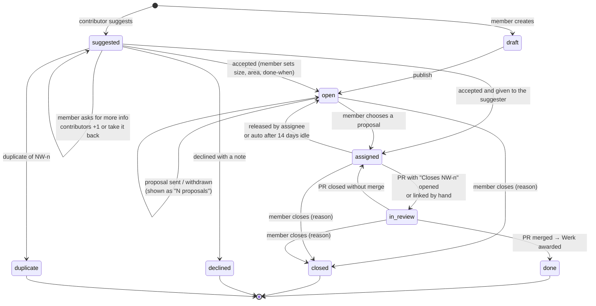

# Contributor task board — design

Status: **draft for review**. Product and UI design only. No code, no schema change yet.

Clickable prototype (private claude.ai artifact; ask Haodong for access):
https://claude.ai/artifact/7rbSjcW1yyEiY9XpCpM6So — the bar at the top switches page, viewer
(visitor, contributor `@lena-k`, member), desktop or phone frame, and light or dark.

## Why

We are closing the recruiting entry (`/join`, "Apply to join"). We don't have the people to
mentor newcomers through whole projects. Instead, anyone can help build the software Novawerk
runs on (the site, the admin panel, the API, the agents) through an open task board:

1. Anyone browses open tasks. No account needed.
2. A visitor makes a **contributor** account: GitHub sign-in (to match pull requests), or an
   emailed code as a fallback.
3. They propose a plan on a task. Several people may propose. A member picks one.
4. The chosen person gets the contribution guide, opens a PR that says `Closes NW-42`, and we
   review on GitHub.
5. When the PR merges, the task is done and they earn the task's points.

**Contributors are not Members.** Members are the core team (`members`, "everyone is a Member,
no tiers"). Contributors get their own account type, and there are no tiers or ranks among
them either. A contributor never gets admin panel access.

## The name for points: **Werk**

| Candidate | Reads as | Verdict |
|-----------|----------|---------|
| **Werk** | "+3 Werk", "24 Werk". Our own word: Novawerk is a workshop, werk is the work done in it. | **Recommended.** Uncountable, like "work", so it doesn't sound like a score. |
| Rivets | Small parts that hold a build together. "+3 rivets". | Good second. Slightly cute. |
| Marks | A maker's mark on finished work. | Sounds like school grades. |
| Sparks | Energy, ideas. | Generic; used by many apps. |
| Bolts | Workshop parts. | Reads like currency ("10 bolts"). |

Sizes and their Werk: **S = 1, M = 3, L = 8, XL = 20**. Werk is recognition only. It never
turns into money, there are no levels, and the copy says so wherever Werk appears.

## Information architecture

```
novawerk.io
├── /                       Home. "Join Novawerk / Apply to join" → "Contribute"
├── /join                   308 → /contribute (keep old links working)
├── /contribute             What contributing is, how it works, featured tasks, sign-in, newsletter
├── /tasks                  The board: filters, list or board view, "Suggest a task"
│   ├── /tasks/suggest      Suggest an improvement or a bug
│   └── /tasks/NW-42        Task detail: description, done-when, status, proposals, thread
├── /contributors           Contributor wall: newest faces first, A–Z, area filter (no ranks)
├── /u/<handle>             Public profile (opt-in)
│   └── /u/<handle>/edit    Edit mode with live preview
├── /sign-in                GitHub or email code → first-run setup
├── /settings               Account, notifications, privacy, delete account
│   └── /settings/tokens    Personal access tokens, MCP and CLI setup
├── /newsletter             Archive of past issues + signup
│   ├── /newsletter/2026-09 Web version of one issue
│   ├── /newsletter/confirmed
│   └── /newsletter/unsubscribed
└── (footer)                Newsletter signup on every page

admin.novawerk.io  (members only; new sidebar groups)
├── Contributors: Tasks (list, create, edit), Suggestions (triage), Proposals (review queue), Discussions (moderation), Werk (ledger, manual change)
└── Newsletter: Issues (list, editor with preview, test send, one approval per issue), Subscribers (exists today)
```

### Site chrome changes

- `apps/web/components/site-chrome.tsx`: header gets a **Tasks** nav link; the ink header
  button "Join" becomes **Contribute** (`/contribute`). Signed-in contributors see **My tasks**
  and an avatar menu (Profile, Settings, Tokens & agents, Sign out) instead of Contribute.
- `apps/web/components/mobile-menu.tsx`: same links; "Contribute" replaces "Join".
- `apps/web/app/page.tsx`: hero second button "Join Novawerk" → **Contribute**; the get-involved
  card "Join Novawerk / Apply to join" → **Contribute to our tools / See open tasks**.
- Footer: "Join" → **Contribute**, add **Open tasks**, add the newsletter signup column. The
  existing email and GitHub links stay as they are.
- `@nw/contracts`: `CTA_TARGETS` gains `contribute`; `join` stays readable for old events.
- `/join` redirects (308) to `/contribute`. The application wizard and its intake chat retire.

## Visual direction

- **Public pages** follow `apps/web` as it is today, which is stricter than the older VI doc:
  zinc canvas `#f4f4f5`, white paper, near-black ink, thin lines, **square corners**, Geist and
  Geist Mono, green `#1f7a4a` as the only accent. One italic accent word per hero.
- **Status** uses a small square dot, not colour blocks: grey open, amber has proposals, blue
  in progress, violet in review, green done, dark grey closed. Semantic, so it doesn't count as
  a second accent.
- **Size** is a two-part badge: `M | 3 Werk`.
- **Dialogs** follow the VI's shape and containment rules even on the square-cornered site:
  16 px container, 12 px fields and buttons, pill segmented controls, a tinted header band,
  one green action. They take the page's theme (never a dark panel over a light page). The
  green button fill stays `#1f7a4a` in both themes so white text passes AA; the lighter green
  is for text only.
- **Tags** are one component: size (`S · 1 Werk`), area, skills and type share height, border
  and type; area adds a small square marker.
- **Dark mode** is new for the public site. The prototype defines a dark token set (lighter
  green `#4cb07a` on `#0c0c0e`). It ships with task NW-43, not with the board.
- **Admin** pages use shadcn base-vega, zinc/neutral: white or zinc-950 ground, rounded cards,
  zinc-900 primary buttons. No cream, and green is not the primary colour there.
- **Profile accents** come from six presets that pass AA in both themes: green, blue, teal, plum,
  amber, ink. Banners: plain, grid, dots, star. No custom colours or uploaded banners.

## Pages and their states

### /contribute
Hero:

> Help build an *AI-native* community.
>
> Our agents read every pitch, draft our posts and prepare our meetings. The task board is
> open, and your agent is welcome too.

Buttons: **Find a task** (primary, `/tasks`) and **Set up your agent** (`/settings/tokens`).
Visitors also get a small "Sign in with GitHub" link; signed-in people find **My tasks** in the
header. Every claim is true today (intake, promo, all-hands prep and the standup digest); don't
add others.

<!-- Once the public repo question is settled (open question 1), the subline can become:
"The code is open, and so is the task board. Your agent is welcome too." Not before. -->

Then the pledge line, **How it works** (4 real
steps), **What Werk is**, **What to expect** (not membership; we don't mentor whole projects;
one task at a time), three featured open tasks, **Work with your coding agent**
(→ tokens), newsletter signup.
States: visitor · signed in · arrived from `/join` (info note).

### /tasks
Header with counts (open · in progress · done this season), **Suggest a task**, List / Board
toggle. Filters: search (title or id), area chips (multi), size chips (multi), status (Active =
default, Suggested, Open, Has proposals, In progress, In review, Done, Closed, All), skills
select, "Clear N filters".
On a phone, area and status chips scroll sideways in one row.

- **List row**: id · title · area · skills · posts · updated · size badge · status
  ("Open", "3 proposals", "In progress · @mira", "In review · PR #212", "Done · +1 Werk").
- **Board**: six columns (Suggested, Open, Proposals, In progress, In review, Done); scrolls
  sideways on a phone.
- **Empty (filters)**: "No tasks match these filters" + Clear filters + Suggest a task.
- **My tasks** (`/tasks?mine`): tasks assigned to me and pending proposals; empty state points
  to open tasks.

### /tasks/NW-42
Main: id + status, title, one-line summary, **What and why**, **Done when** (acceptance
criteria; ticked when done), **Proposals** (count, list with handle, rough timeline, date, state:
Pending / Chosen / Not chosen), **Discussion** (posts and one level of replies; Reply and
Report; "via agent · <token name>" tag on posts made with a token; Novawerk tag on members).
Side: the action card, facts (size, area, skills, assignee, pull request, updated), status
timeline (done steps filled, future steps hollow). On a phone the action card moves under the
title and the side cards follow the main column.

Action card by viewer and state:

| State | Visitor | Contributor | Assignee | Member |
|-------|---------|-------------|----------|--------|
| Open / has proposals | Propose a plan → sign-in dialog | **Propose a plan** | — | Review proposals in admin |
| My proposal pending | — | "Your proposal is waiting" + Edit / Withdraw | — | — |
| Not chosen | — | Private note from the member + a suggested task | — | — |
| In progress / in review | "Someone is on this" | same | Guide, link PR, release | same as visitor |
| Done | "Merged … N Werk to @who" | same | same | same |
| Closed | Reason | same | same | same |

### Propose flow
A dialog on desktop; a full-screen sheet with a sticky footer on a phone.

- **Header**: the task title; under it a small line `NW-41 · web · S · 1 Werk`. One close
  control: an × icon top right (plus Cancel in the footer, and Escape).
- **What you'll change** and **How you'll test it**: two short fields with plain prompts
  ("Which files or screens you'll touch, and the idea in a sentence or two." / "The tests
  you'll add, or how you'll check it by hand."). Markdown works. Fields use a darker border
  (`#8e8e96` light) and placeholders that pass contrast.
- No questions field. A link under the fields: **Have a question? Ask in the thread instead**
  (closes the dialog and focuses the thread composer), so answers stay public.
- **Rough timeline**: segmented pills, A few days · About a week · Two weeks, with the rule
  under them: "Tasks go back on the board after 14 days without activity."
- **Done when**: a collapsed list of the task's criteria inside the dialog.
- **Before you send** box: "2 others proposed. A member picks one plan." (or "You're the first
  to propose."), "You can hold 1 task at a time" (plus "You hold NW-48 now…" when true), and
  "What happens next: a member replies within about a week. Proposals are public on the task."
- Required tick: "I read **what done means** for this task, and I'll release it if I can't
  finish." The link opens and scrolls to the criteria.
- **Send proposal** stays disabled until "What you'll change" has text and the box is ticked.
- **Sent**: toast, then the action card "Your proposal is waiting. A member replies within
  about a week. You can edit or withdraw it until then." with **Edit proposal** (same dialog,
  prefilled, "Save changes") and **Withdraw**.
- Afterwards the proposer sees **Chosen** (the guide appears) or **Not chosen** (a note only
  they see).

Limits: 5 proposals a day; one task in progress at a time.

### Assignee view
- **Inactivity reminder** after 7 days without a commit on the linked PR or a post from the
  assignee: "No activity for 9 days… we release it on Oct 19". Buttons: Post an update, I need a
  week more (once). Auto-release at 14 days.
- **Contribution guide** (from the admin template plus task notes): get the code, branch,
  our rules (schema → `pnpm db:generate`, `@nw/contracts`, `packages/config` only reads env),
  open the PR with `Closes NW-48` and DCO sign-off, where to ask. "Copy as Markdown" for agents.
- **Link a PR by hand** when the webhook misses it.
- **Release task** with an inline confirm. The task goes back to Open; the timeline records it
  ("Released by @jonas: no time this month"); nothing counts against the person.

### /u/<handle> and edit mode
Banner (preset), avatar (GitHub picture, initials, or upload, checked before it shows), name,
@handle, bio (160), stats (done · in progress · Werk), pinned tasks (≤ 3), About (Markdown:
bold, lists, links; no images or HTML; 1500 chars), In progress list, Done list (+Werk, merged
date), links (≤ 4), contributor since.
Edit mode: form on the left, live preview on the right (stacked on a phone), Save / Cancel.
Public profile toggle: off hides the page and removes the person from /contributors; tasks
still show the handle, unlinked.

### /contributors (the contributor wall)
- **Who**: everyone with at least one merged task or an accepted suggestion (an "idea" mark).
  Only public profiles, and anyone can leave the wall in Settings (Privacy: "Show me on the
  contributors wall and in the GitHub README").
- **First contributions** strip at the top: the last few people whose first PR merged, with
  that task.
- **Card**: avatar, handle (+ idea mark), one-line bio, the areas they worked on, "last merge
  <date>" (or "idea accepted <date>"). Click → `/u/<handle>`.
- **Order**: newest faces first (most recent contribution) by default, or A–Z. Never by Werk,
  and no Werk number on the wall; Werk stays on the profile. No numbers in front of names.
- **Filter** by area (web, admin, api, agents, docs, ci, posts) and **Initiators**. Empty area:
  "Nobody here for <area> yet. Be the first."
- **Initiators**: people who started a portfolio project (`project_members.role = "Initiator"`)
  stand on the wall next to contributors, with an **Initiator** mark and "Started <project>"
  linking to the project. Their profile shows the same line. Same no-ranking rule. Initiators
  are Members, not contributors, so they need an opt-in public profile (open question 14).
- **Entry points**: a "People who built this" section on `/contribute` and on `/about` (a row of
  avatars + "See everyone"), and "Contributors" in the footer.

### "One block at a time" (聚沙成塔)
A small animated scene at the bottom of `/contributors` and a smaller one beside "People who
built this" on `/contribute`.

- **Style**: 2.5D pixel art in 2:1 isometric ("45°"). The scene is drawn at low resolution
  (tiles 12×6 art px, cube height 5) and scaled up 2× (phone) or 3× (desktop) with no
  smoothing, so every edge is a crisp pixel step. Cubes have three shaded faces (top light,
  left base, right dark). The tower stands on a checkered ground slab with a soil edge.
- **Blocks**: every merged task is a run of cubes on a 5×5 tower: S 1 cube, M 2, L 3, XL 4.
  Colour by area from the brand palette (web green, admin zinc, api blue, agents deep green,
  docs warm grey, ci light green). Oldest at the bottom; each layer turns its rows 90°.
- **The tower** wears a pixel Nova Star above it that bobs gently and rises with each layer.
- **People**: every contributor is a pixel figure a few pixels tall (head, body in the colour
  of the area they work in most, two legs, a small shadow). They idle on the ground around the
  tower: a few walk, some sit, a couple hammer. Initiators stand near the front holding a
  flag; the project's name shows on hover. People without a public profile appear as unnamed
  figures.
- **On load** the tower stands as it is. Blocks merged since the visitor's last visit (count in
  `localStorage`, wrapped in try/catch) are carried in one by one: the person who did the task
  walks to the ladder leaning on the tower, climbs with the block over their head, sets it in
  its slot (it drops a few pixels and settles), climbs down and walks back. First visit: the
  last five. Nothing new: the newest one again.
- **Hover or tap** a figure: handle, how many blocks, which areas, link to the profile
  (initiators: "Started <project>"). A block: task title, who, merge date, size, area, link to
  the task.
- Line under it: "142 tasks merged by 38 people. One block at a time."
- **Reduced motion**: a still scene (no walking, no carrying, no bob). Light and dark tokens.

Implementation notes:
- A client component (`"use client"`): an offscreen low-resolution canvas for the pixel art,
  copied to the visible `<canvas>` with `imageSmoothingEnabled = false` (device pixel ratio
  capped at 2). Cubes and figures are drawn in painter's order by x + y + z; the ladder and
  anyone on it or on top go last. The block list (id, title, area, size, who, merged date) comes from the cached
  `projects`/`tasks` data; the last-visit comparison and all timing run in `useEffect`, so the
  prerendered part has no `Date.now()` (Next 16 Cache Components).
- The layout (block slots, ladder line, figure spots) is a pure function of the block list and
  the width, so every visitor sees the same tower.
- Phones: at most 3 walking figures (6 on desktop), the rest at rest; the loop pauses when the
  canvas is off-screen (IntersectionObserver) and stops when the scene is still.
- The canvas has an `aria-label` with the summary line; a visually hidden list of the latest
  ten merges gives keyboard and screen-reader users the same links.

When the tower gets very tall (proposal): the tower is a **season**. At about 300 blocks it is
finished: the star's core lights up, the tower slides left and shrinks a little, and a new
tower starts beside it with an empty base; the people walk over. Older towers stay in the
scene as a skyline (up to three, then a "See past seasons" link). Each tower is labelled with
its season ("Summer 2026"). Until then the tower shrinks to fit the scene. We prefer this over
a camera that pans up: the whole story stays visible in one still frame, which also suits
reduced motion and thumbnails.

### GitHub README block
The `novawerk-workspace` README gets a **Contributors** section: an avatar grid (GitHub avatars,
48 px, no counts, newest first), each linking to `novawerk.io/u/<handle>`, plus a link to the
wall. `.github/workflows/contributors.yml` rewrites only the lines between
`<!-- contributors:start -->` and `<!-- contributors:end -->`. It runs on a `repository_dispatch`
the API sends after it awards Werk, and nightly as a safety net. It reads
`GET /public/contributors?sort=newest` (so the same visibility rules apply) and commits as
`novawerk-bot` only when the block changed. Initiators appear in the grid too. The repository
is now `Novawerk/novawerk-workspace`.

### Sign-in and account
- `/sign-in` and the sign-in dialog: Continue with GitHub (primary), or email a code. Copy:
  "Signing in creates a contributor account. It isn't Novawerk membership."
- First run: handle (from GitHub), display name, **Show my profile publicly** (off by default),
  **monthly newsletter** (off by default, double opt-in), pledge + DCO tick.
- `/settings`: sign-in methods (GitHub linked; email masked, visible only to the owner),
  notifications (on-site; monthly newsletter), privacy (public profile; download my data as
  JSON), **Delete account** with type-your-handle confirm. Deleting removes profile, proposals
  and tokens; merged work stays in git history and tasks show "a former contributor".

### /settings/tokens (agent access)
- Token list: name, scopes, last used, expiry, Revoke.
- New token: name, expiry (30 or 90 days), scopes. The secret shows once.
- Scopes: `tasks:read` (always on; raises the rate limit), `proposals:write`,
  `discussion:write`, `tasks:work` (link PR, release own task), `suggestions:write` (suggest and
  +1),
  `profile:write`.
- Tokens can't manage tokens, change sign-in, or delete the account. Those stay browser-only.
- Copyable MCP config (`https://api.novawerk.io/mcp`, bearer token), a `claude mcp add` line, a
  `curl` example, and the tool table below.
- Everything a token does carries the person's handle plus "via agent · <token name>".
- An agent can draft a proposal; the person confirms it in the browser before it counts
  (see open questions).

### Admin (apps/admin, new "Contributors" group)
- **Tasks**: table (id, title, area, size, status, proposals, assignee, updated, "stale" flag);
  filters All / Needs a decision / Stale; New task.
- **Task editor**: title, summary, what and why (Markdown), done-when lines, size segmented
  control with a hint per size, area, skills tags, repository, reviewer, contribution-guide
  template + task notes, Save draft / Publish, Close task with a public reason.
- **Proposals**: queue grouped by task, oldest first. Each proposal shows the person's done /
  in-progress count. **Choose this plan** turns the others into editable decline notes
  (prefilled "Thanks for the plan. We picked another one this time."); one confirm assigns
  and sends the notes on the site. Side card: how we decide (meets every done-when line,
  prefer people with nothing in progress, reply within a week).
- **Discussions**: Reported (hide post, keep, lock thread, suspend account) and Unanswered
  questions. Hidden posts read "Hidden by Novawerk: off-topic or spam".
- **Werk**: ledger (when, who, change, reason, by: GitHub or a member) and **Adjust Werk**
  (contributor, ± amount, required reason the contributor sees).

## Suggested tasks

Contributors can suggest improvements and bugs for our own tools. Suggesting earns credit, never
Werk: Werk comes only from merged work, so nobody games it with ideas.

- **Entry**: "Suggest a task" on `/tasks` (header and empty state) → `/tasks/suggest`. Visitors
  are asked to sign in first.
- **Form**: title · type (Improvement / Bug, as pills) · what and why (the prompt changes with
  the type: for a bug, what happened, what you expected, the steps) · where in the product
  (site, admin, API, agents, posts tooling, videos, not sure) + optional page or path ·
  optional screenshot (PNG/JPG, 2 MB, "no personal data") · **I'd like to do this myself**.
  No size, no Werk: a member sets them. Send stays disabled until title and body have text.
- **Boundaries** in a side card: a new product idea → pitch it on `/submit`; a **security
  issue must not be posted here** → email the private security contact; suggestions are
  public and nobody can propose on them until accepted. Also shows "You have N of 3 open
  suggestions".
- **On the board**: status **Suggested** (dashed square), "Suggested by @x" in the row; a
  "needs info" variant when a member asked a question. The page shows type and where instead of
  size; no proposals section; the thread is open for comments.
- **Triage** (admin → Suggestions, oldest first, reply within a week):
  - **Accept**: the member sets size, area and done-when lines. It becomes **Open**, or, when
    the suggester ticked "do it myself", the member can **assign it to them directly** and skip
    proposals.
  - **Duplicate**: link the existing task; the suggestion closes and points there.
  - **Ask for more info**: the question goes into the thread; the suggestion stays open with a
    "needs info" flag.
  - **Decline** with a note shown on the closed suggestion.
  - A security report posted by mistake: hide the post and move it to the private contact.
- **Credit**: "Suggested by @x" stays on the task for good (side facts, timeline, list row).
  The profile gets an **Ideas accepted** list and count.
- **Limit**: 3 open suggestions per contributor.
- **Upvotes (+1)** on Suggested tasks, in the list row and on the task page:
  - signed-in contributors only, one per account, click again to take it back; no downvotes;
  - the suggester can't vote on their own suggestion; members triage and don't vote;
  - the count is public; who voted shows on hover and as a small "+1 from @a, @b" list on the
    task page;
  - `/tasks` gets a **Most wanted** sort (suggestions by votes);
  - copy next to votes: "Votes help us choose. They don't decide: a member still triages every
    suggestion.";
  - no Werk for votes, given or received;
  - the triage queue has a Votes column and sorts by it.

## Task lifecycle



- Declined and duplicate suggestions are closed tasks with a reason; they stay readable.
- Votes only exist while a task is Suggested. They are kept (read-only) after triage, as a
  record of demand, and never move the task by themselves.
- "Proposed" is not a stored state. It is `open` with at least one pending proposal; the board
  shows it as "N proposals".
- **Released** is an event, not a state: the task returns to `open` and the timeline keeps it.
  Pending proposals from before the assignment are not revived; people propose again.
- A PR counts only if its author's GitHub account is linked to the assignee. Werk is awarded
  once per task; a revert later is handled with a manual adjustment.
- Every transition writes a task event (who, when, from, to, note). The timeline and the
  Werk ledger read from those events.

## Machine-readable counterparts

Public reads need no token. Contributor actions use a personal access token (or the browser
session). Member actions stay in the admin API and the admin assistant.

| Page | MCP tool | REST |
|------|----------|------|
| /tasks | `list_tasks(area?, size?, status?, skills?, q?)` | `GET /public/tasks` |
| /tasks/NW-42 | `get_task(id)` | `GET /public/tasks/:id` |
| proposals list | `list_proposals(id)` | `GET /public/tasks/:id/proposals` |
| thread | `get_thread(id)` | `GET /public/tasks/:id/posts` |
| Propose | `propose(id, approach, eta)` | `POST /contrib/tasks/:id/proposals` |
| Edit / withdraw | `update_proposal`, `withdraw_proposal` | `PATCH` / `DELETE /contrib/proposals/:id` |
| Post / reply | `post_comment(id, body, reply_to?)` | `POST /contrib/tasks/:id/posts` |
| /tasks/suggest | `suggest_task(title, type, body, where, do_it_myself?)` | `POST /contrib/suggestions` |
| +1 on a suggestion | `upvote_task(id)` / `remove_upvote(id)` | `PUT` / `DELETE /contrib/tasks/:id/vote` |
| My tasks | `my_tasks()` | `GET /contrib/me/tasks` |
| Contribution guide | `get_guide(id)` | `GET /contrib/tasks/:id/guide` |
| Link PR | `link_pr(id, url)` | `POST /contrib/tasks/:id/pr` |
| Release | `release_task(id, reason?)` | `POST /contrib/tasks/:id/release` |
| /u/handle | `get_profile(handle)` / `update_profile(…)` | `GET /public/contributors/:h` / `PATCH /contrib/me/profile` |
| /contributors | `list_contributors(area?, sort: "newest" \| "az")` | `GET /public/contributors` |
| /settings | `whoami()` | `GET /contrib/me` |
| /newsletter | `list_issues()` / `get_issue(slug)` | `GET /public/newsletter[/:slug]` |
| Admin | member-only tools in the admin assistant: `create_task`, `approve_proposal`, `decline_proposal`, `triage_suggestion`, `adjust_werk` | `/admin/tasks/*`, `/admin/suggestions/*` |
| GitHub | — | `POST /webhooks/github` (PR opened, closed, merged) |

The MCP server is a thin layer over the same handlers (`/mcp` on the API). Rate limits per
account: 5 proposals and 30 posts a day.

## Newsletter

A monthly digest: a short note from us, the month's published posts, new open tasks, and
merged contributions with thanks. Today there is only a signup box on `/about` and the
`newsletter_subscribers` list in admin.

- **Signup** in the footer (every page), on `/contribute`, on `/newsletter` and under each
  issue; an opt-in tick at contributor sign-up (off by default) and a toggle in settings.
- **Double opt-in.** After submit: "Check your inbox. Nothing arrives until you click it."
  The link lands on `/newsletter/confirmed`. Every issue has a one-click unsubscribe that lands
  on `/newsletter/unsubscribed` (with Subscribe again). `newsletter_subscribers` needs a
  confirmed-at and a token; today a row is subscribed on insert.
- **Archive** `/newsletter` lists sent issues; `/newsletter/<yyyy-mm>` is the web version.
- **Email template** (light only, 600 px, table layout and inline styles in `@nw/email`):
  header with the star and month · title + note signed by a member · New posts · Open tasks
  (up to three) + "See all open tasks" · Merged this month (task, @handle, +Werk, "Thank you,
  <first name>") · footer with why you get it, Unsubscribe, Read on the web, address.
- **Admin**: issue list (draft / sent, sent date, recipients, bounced, unsubscribed) and the
  issue editor: subject, title, note; posts, tasks and merges filled in from the site with
  ticks to leave items out; live preview (email / web); **Send a test to me** (goes to the
  member's own novawerk.io inbox); **Approve and schedule** — one approval for the whole issue,
  cancellable until sending starts.
- **No open or click tracking.** We count sends, bounces and unsubscribes only.
- Contributors with a private profile appear as "a contributor"; anyone can ask to be left out.
- This fits the outbox rule as a new kind of approval: one outbox entry per issue, approved
  once, then sent in batches. It needs an ADR next to NB-ADR-0008/0010.

## Privacy and safety

- No emails shown anywhere public. The settings page masks the owner's own address.
- Profiles are opt-in public. Private profiles: handle shown on tasks, not linked, not listed.
- Delete account and download data from settings.
- Analytics stay cookie-less through `track()`: `cta_click` with target `contribute`, and
  counts such as `task_view`, `propose_open`, `newsletter_signup`, with no ids and nothing a
  visitor typed.
- Screenshots on suggestions go to the public Blob store only after a member accepts; until
  then they sit in the private store.
- Moderation: report on every post, hide / lock / suspend in admin, the pledge applies to every
  thread.

## Data model sketch (for the build, not this PR)

`contributors` (handle, name, bio, links, about, accent, banner, public, on_wall, github_id,
email, created_at), `contributor_tokens` (hashed secret, scopes, expires_at, last_used_at),
`tasks` (NW id, title, summary, body, criteria, area, size, skills, repo, status, assignee_id,
pr_url, guide_template, closed_reason, suggested_by, kind, where, wants_it, duplicate_of),
`task_votes` (task, contributor, unique per pair), `task_proposals`, `task_posts` (parent_id, via_token_id,
hidden_at), `task_events`, `werk_ledger` (contributor, delta, reason, task_id, by_member_id),
`newsletter_issues` and confirmed-at on `newsletter_subscribers`. All in
`packages/db/src/schema.ts` with a generated migration.

## Open questions

1. ~~The code is private.~~ **Decided:** the code moves to the public repo
   `Novawerk/novawerk-workspace`; `records/` stays private. The contribution guide forks it.
2. ~~Contributor notifications vs. the outbox rule.~~ **Decided (Haodong, Oct 15):** emails
   to contributors (chosen, not chosen, reminders, sign-in codes) are sent normally, without
   outbox approval. The outbox gate stays for everything else sent outside Novawerk. The rule
   in CLAUDE.md and the email package need this exception written down.
3. **DCO or CLA?** The design assumes DCO sign-off (`git commit -s`). Licence of the public repo.
4. **Are proposals public?** The design shows proposals to everyone and keeps decline notes
   private. The alternative is proposer + members only.
5. **Agent-made proposals:** count at once, or need a browser confirm? The design asks for a
   confirm.
6. **Inactivity timings:** reminder at 7 days, auto-release at 14. One extension per task?
   (The propose dialog already tells people about the 14 days.)
7. **Werk name.** Recommendation: Werk. Second choice: Rivets.
8. **README avatars**: GitHub avatars (designed) or the novawerk.io avatar, which may be initials?
9. **XL tasks:** allow them, or require splitting into L tasks?
10. **No private security contact exists yet.** The suggest form points to
    `security@novawerk.io` (placeholder); set it up, plus `/.well-known/security.txt`.
11. Community chat (Discord) deferred until there are enough active contributors.
12. Dialog shape: the dialogs use VI radii (16 / 12 px, pills) while the rest of the site is
    square. Keep the mix, or square the dialogs too?
13. Newsletter sender address (`news@novawerk.io`?) and whether `/about` keeps its own signup.
14. **Initiators on the wall** are Members (`members`, `project_members`), not contributors.
    Give Members an opt-in public profile at `/u/<handle>`, or link a member to a contributor
    account?
